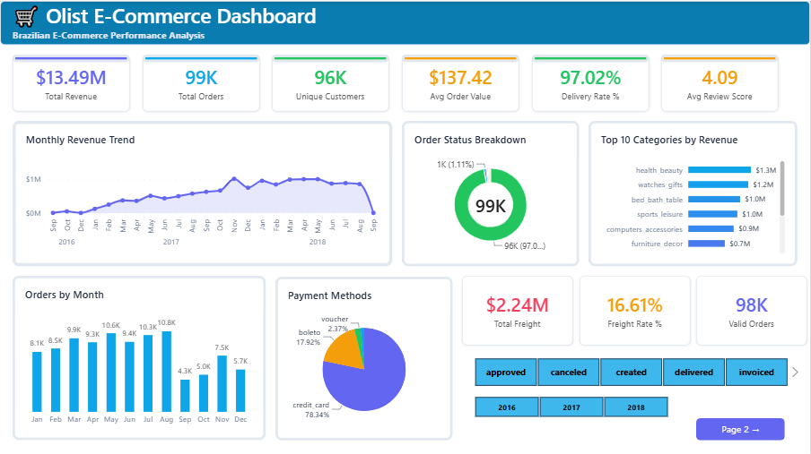
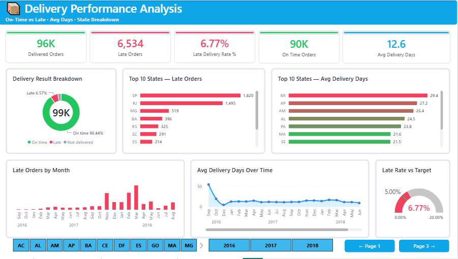
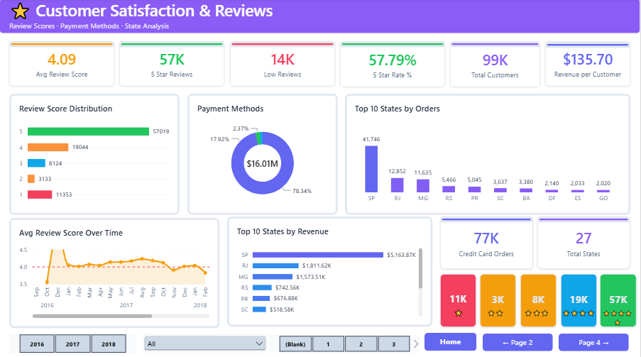
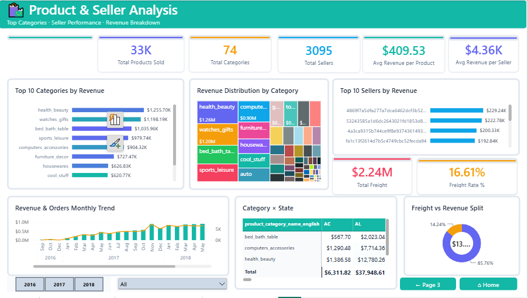

🛒 Olist E-Commerce Dashboard — Power BI

📌 Overview

Interactive Power BI dashboard analyzing Brazilian e-commerce
performance on the Olist platform — covering sales, delivery,
customer satisfaction and product performance across 99,441 orders.

Built with a white infographic style — clean cards with
colored accents, gradient charts, and multi-page navigation.

---

📸 Preview






---
📄 Dashboard Pages

| Page | Header | Focus |
|---|---|---|
| 1 — Sales Overview | 🟣 Indigo | Revenue · Orders · KPIs · Trends |
| 2 — Delivery Analysis | 🔵 Blue | Late Orders · Days · State Breakdown |
| 3 — Customer & Reviews | 🟣 Purple | Satisfaction · Payments · Scores |
| 4 — Product & Seller | 🟢 Teal | Categories · Sellers · Revenue Mix |

---

📊 Key Metrics

| Metric | Value |
|---|---|
| 💰 Total Revenue | $13,591,644 |
| 💳 Total Payment | $16,008,872 |
| 📦 Total Orders | 99,441 |
| 👥 Total Customers | 96,096 |
| ⭐ Avg Review Score | 4.09 / 5 |
| 🚚 Delivered Orders | 96,478 (97.02%) |
| ⏰ Late Delivery Rate | 6.77% |
| 📅 Avg Delivery Days | 12.56 days |
| 🏪 Total Sellers | 3,095 |
| 🛍️ Total Products | 32,951 |
| 📂 Total Categories | 74 |
| 💳 Credit Card Rate | 73.92% |

---

⚠️ Key Insights

- ✅ 97.02% delivery success rate — excellent fulfillment
- ✅ 57.78% of reviews are 5-star — high satisfaction
- ✅ Orders arrive ~11.88 days early on average
- ⚠️ Freight costs 16.57% of total revenue — high logistics cost
- ⚠️ 14,486 low reviews (≤2 stars) — area for improvement
- 🏆 health_beauty is top category at $1.25M revenue
- 💳 Credit card dominates at 73.92% of all payments
- 🌍 SP state leads with most orders by far

---

🧮 DAX Measures (38 Total)

| Folder | Measures |
|---|---|
| 📂 Sales | Total Revenue · Total Payment · Total Freight · Freight Rate % · Avg Order Value |
| 📂 Orders | Total Orders · Delivered Orders · Cancelled Orders · Delivery Rate % · Cancellation Rate % |
| 📂 Delivery | Late Orders · On Time Orders · Late Delivery Rate % · Avg Delivery Days · Avg Delay Days |
| 📂 Reviews | Avg Review Score · 5 Star Reviews · Low Reviews · 5 Star Rate % · Score 1-5 Counts |
| 📂 Customers | Total Customers · Total States · Revenue per Customer |
| 📂 Products | Total Categories · Total Products Sold · Total Sellers · Avg Rev/Product · Avg Rev/Seller |
| 📂 Payments | Credit Card Orders · Avg Installments · Credit Card Rate % |

---

🗂️ Data Model — 7 Tables

| Table | Rows | Description |
|---|---|---|
| Orders | 99,441 | Main order fact table |
| Order Items | 112,650 | Line items per order |
| Payments | 103,886 | Payment transactions |
| Reviews | 99,224 | Customer review scores |
| Customers | 99,441 | Customer details + location |
| Products | 32,951 | Product catalog + categories |
| Sellers | 3,095 | Seller details + location |

---

🎨 Design System

| Element | Value |
|---|---|
| Theme | White Infographic |
| Background | `#FFFFFF` White |
| P1 Header | `#6366F1` Indigo |
| P2 Header | `#0EA5E9` Sky Blue |
| P3 Header | `#8B5CF6` Purple |
| P4 Header | `#14B8A6` Teal |
| Positive | `#22C55E` Green |
| Alert | `#F43F5E` Rose |
| Font | Segoe UI |
| Canvas | 1280 × 720 px |

---

🗂️ Repository Structure

```
Olist-Ecommerce-Dashboard/
│
├── 📊 Olist_Project.pbix
├── 📄 README.md
├── 📁 screenshots/
│   ├── page1_sales_overview.png
│   ├── page2_delivery_analysis.png
│   ├── page3_customer_reviews.png
│   └── page4_product_seller.png
└── 📁 theme/
    └── Olist_White_Infographic_Theme.json
```

---

🛠️ Built With

- Power BI Desktop
- DAX(Data Analysis Expressions)
- Olist Brazilian E-Commerce Dataset (Kaggle)
- White Infographic Design Style

---

📂 Dataset Source

[Olist Brazilian E-Commerce Dataset — Kaggle](https://www.kaggle.com/datasets/olistbr/brazilian-ecommerce)

> Brazilian e-commerce public dataset of orders made at Olist Store
> from 2016 to 2018 across multiple marketplaces in Brazil.

---

👤 Author

Tanveer — Power BI Developer & Data Analyst
- 38 Custom DAX Measures
- White Infographic Dashboard Style
- Brazilian E-Commerce Analysis
- 4-Page Interactive Report
